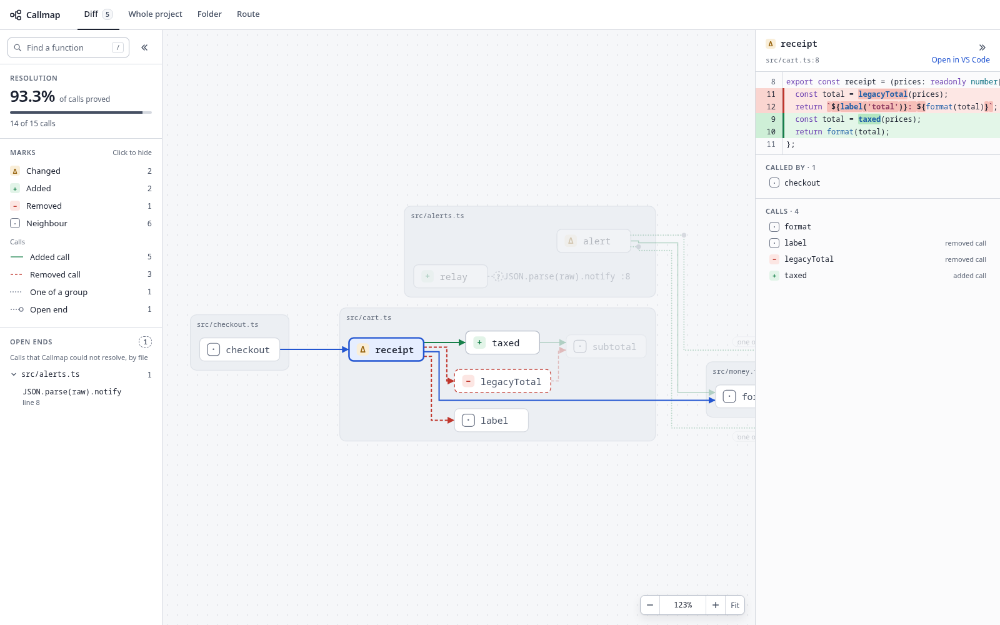
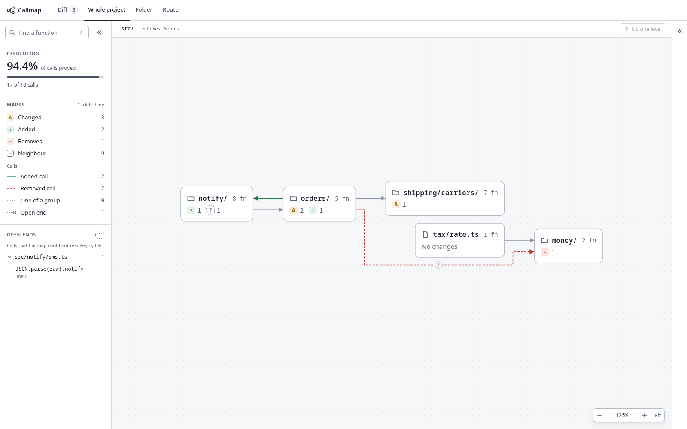
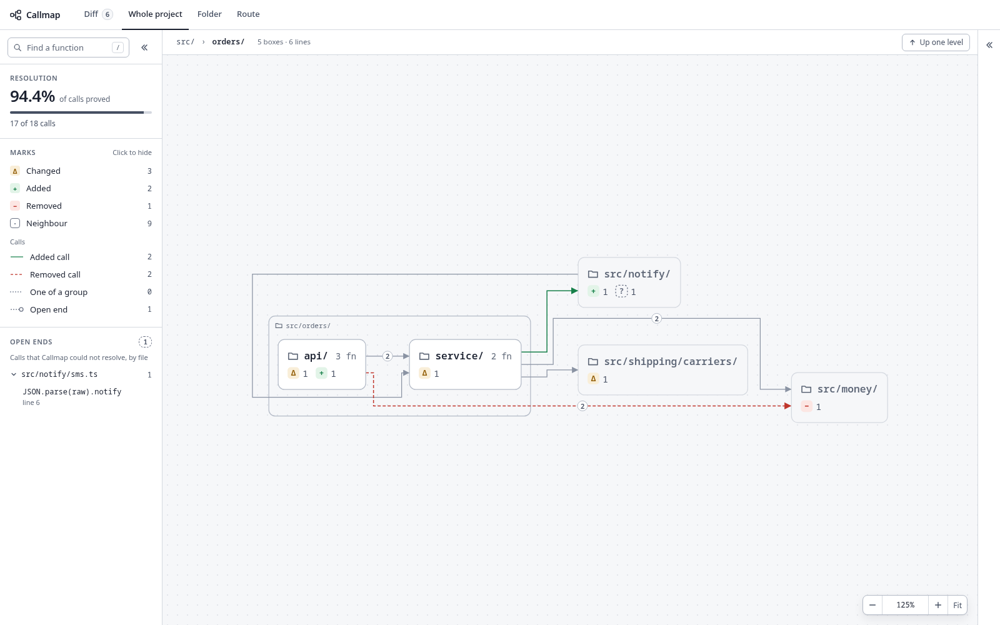

# Callmap

Callmap is a call graph reader for an engineer who still reads code. It reads a branch of a TypeScript repo with the TypeScript type checker, with no AI, and writes one HTML page for the code review. The page shows each function that the branch added, removed or changed, inside the frame of its file. Around each one it shows its callers and its callees, and it marks each call that the branch added or removed. Tabs show the same graph as the whole project, as one folder, or as one route. The same commits always give the same page and the same layout.

## Install

Callmap needs Node 22.18 or later. Run it in the repo of the branch, with no install:

```sh
npx @callmap/cli review
```

To keep the `callmap` command, install the package once:

```sh
npm install --global @callmap/cli
```

The examples below use `callmap`. With `npx`, write `npx @callmap/cli` in its place.

### From a clone

To try a change to Callmap on another repo, install the `callmap` command from a clone of this repo:

```sh
npm install
npm link -w @callmap/cli
```

`npm install` builds the command into `packages/cli/dist/`, and the link points at that build. So run `npm run build` after each `git pull` or change. `npm unlink -g @callmap/cli` removes the command. The tests run the source in `packages/cli/src/`, so they need no build.

## Review a branch

Check out the branch, then run the review in its repo:

```sh
callmap review [<repo>] [--base <commit>] [--scope <glob>]... [--tsconfig <file>] [--out <file>] [--no-open] [--no-cache] [--editor vscode|jetbrains]
```

| Argument            | What it does                                                                            | Default                                          |
| ------------------- | --------------------------------------------------------------------------------------- | ------------------------------------------------ |
| `<repo>`            | The repo to review. Any folder inside it works.                                         | The current folder                               |
| `--base <commit>`   | The commit to compare the branch with.                                                  | The merge base with the default branch           |
| `--scope <glob>`    | Limits the review to the files that the glob matches. Give it once for each glob.       | Every file of the repo                           |
| `--scope '!<glob>'` | Leaves out the files that the glob matches, also when another glob takes them.          | Nothing left out                                 |
| `--tsconfig <file>` | The TypeScript config to read, as an absolute path or a path relative to the repo root. | `tsconfig.json` at the repo root, if it exists   |
| `--out <file>`      | Where the page is written.                                                              | `review-<repo folder>.html` in `$TMPDIR/callmap` |
| `--no-open`         | Writes the page and does not open it, for example to attach it to a merge request.      | The page opens in the browser                    |
| `--no-cache`        | Reads the base again and does not write the cache.                                      | The base comes from the cache if it is there     |
| `--editor <name>`   | The editor that the editor link on each function opens: `vscode` or `jetbrains`.        | `vscode`                                         |

The default branch is the head of `origin`, then the head of any other remote, then `main`, then `master`. The review reads the base commit in a temporary git worktree and removes it at the end, so the checkout and the uncommitted files never move. The worktree links to the `node_modules` folders of the checkout, so the library types resolve on the base too. The command prints the path of the page when it ends.

The command caches the graph of the base, so a second review of the same base reads only the branch. The cache is in `$XDG_CACHE_HOME/callmap/`, or in `~/.cache/callmap/` when the variable is not set. The cache holds one entry for each language of the review. An entry belongs to one language, one base commit, one set of scope globs, one tsconfig, the lock files of that language in the checkout and one version of the extractor of that language. A change of any of them reads the base of that language again, and the entries of the other languages stay. The lock files of TypeScript are the lock files of npm, Yarn, pnpm and Bun. The version of the TypeScript extractor is the version of `@callmap/cli`, the version of its `typescript` and a hash of the extractor source that the build saw, so a new release starts with an empty cache. A run of the source in a clone uses the version of `typescript` and a hash of the extractor source. The cache never holds the graph of the branch. It keeps the 20 newest entries for each repo. A cache file that cannot be read gives a fresh read of the base. You can delete the folder at any time.

A scope glob matches a whole path from the repo root. `*` matches inside one folder, `**` matches across folders, and `?` matches one character. A glob that starts with `!` leaves files out. Quote each glob, so that the shell does not expand it.

A backend in a subfolder of a monorepo, with its tests left out:

```sh
callmap review --tsconfig server/tsconfig.json --scope 'server/src/**' --scope '!**/*.spec.ts'
```

Tests stay in the review unless a glob leaves them out. A test that mocks its calls adds open ends, so it lowers the resolution rate.

## The reader page

The page is one HTML file with no network access, so it opens from a file anywhere. ELK lays out the graph, and the page draws it as SVG. The command lays out the Diff view and the top level of the Whole project view, so they open with no wait. A Diff view over the Diff limit gets no layout. The page lays out the other views and the other levels when you open them. The page stores the file texts as one gzip block, and the browser unpacks it with `DecompressionStream` after the first view draws. Each call is a line that turns only at 90 degrees and never goes through a box. The callers stand on the left and the callees on the right. The page follows the light mode or the dark mode of the system.

Each mark is a small chip with a glyph on a neutral box. The glyph is Δ for changed, + for added, − for removed, · for neighbour, ? for an open end. So a screen full of changes stays calm, and a mark does not depend on colour alone. A removed function also has a dashed border.

A click on a function selects it. The selected function is the only filled box, with a blue border. Its calls in and out get 2 px blue lines and blue count badges. An added or a removed call keeps its colour. The boxes at their other ends do not fade, and the rest fades. A click on the empty graph or the Escape key clears the selection.

The pointer over any box shows the same highlight for that box until the pointer leaves it. The box under the pointer gets a blue border and no fill. This also works on a box that opens a level. The pointer does not open the code panel or the level.

The click also opens the code panel. The panel shows the code of the function in a read-only editor. The editor has syntax highlighting and the line numbers of the file. For a changed function, it shows a unified diff as Git does. Each removed line is red, above the added lines in green, and the exact changed characters are bold. An added function is all green, and a removed function is all red.

Below the code, the lists "Called by" and "Calls" name the callers and the callees, with their marks. A click on a row selects that function.

The top bar holds the tabs of the views. The Diff tab shows the count of changed functions. The code panel is on the right of the graph. The left panel holds the search, the resolution rate and the legend of the marks. It also holds the lists of a view and the open ends.

Each panel collapses and opens with its own button, and a drag on its inner edge changes its width. The graph keeps the selected function in view when a panel opens or closes. The search finds any function in scope by name. Each function carries an editor link that opens its file at its first line.

The legend counts each mark and each kind of call. A click on a mark in the legend hides the functions with that mark and their calls. On a level of the Whole project view, it hides the count of that mark on each box, and it hides a box when every change in it has a hidden mark. A second click shows them again. For example, hide the changed, removed and neighbour marks to see only the added code. The arrow keys and the edge hints skip the hidden functions.

The open ends are grouped by file, with the file that holds the most open ends first. A click on a file opens or closes its list. The panel shows 5 files, and a button shows the rest.

### Zoom and keys

A dense level does not shrink until its text cannot be read. The page opens each view and each level at the zoom of this rule:

```
fit = the zoom where the whole level fits the graph
open zoom = fit, up to 125%,  when fit is 92% or more
open zoom = 100%,             when fit is less than 92%
```

92% is the reading floor: the zoom where the box names are 11 px on the screen. A box name is 12 px at 100%. A support text can be smaller at the reading floor, such as the "N fn" count, the label of an open end and the glyph of a chip. So a level that fits at the reading floor or above opens whole. A larger level opens at 100% on one part of it. That part is the selected box, else the box with the most changes, else the first box on the left. The page puts that box one third from the left edge of the graph. ADR-0018 records the rule and its check on a real review.

The zoom band of the zoom decides what text the graph draws:

| Zoom             | Band | What the graph draws                                                                 |
| ---------------- | ---- | ------------------------------------------------------------------------------------ |
| Less than 60%    | Map  | The boxes and the chips, at their screen size while they fit. A tooltip names a box. |
| 60% to under 92% | Scan | The names at 11 px on the screen, one count on a level box, badges on the path       |
| 92% or more      | Read | All the text                                                                         |

The lines, the count badges and the "one of" labels keep their screen size at every zoom. A frame label keeps its screen size while it fits the header of its frame. At a lower zoom, it shrinks with the frame. A frame label that does not fit cuts the start of its path, so the file name stays.

The zoom controls sit at the bottom right of the graph. They are "Zoom out", "Zoom in", "Fit" and the zoom in percent. The label says "Overview" below 92%. Fit shows the whole level, up to 150%. Drag the graph to pan it, and use the mouse wheel to zoom, from 5% to 150%.

When a level is larger than the graph, an overview map shows at the bottom right. The map shows all the boxes of the level and a frame around the part on the screen. A click or a drag on the map moves the graph to that place. An edge hint on each side of the graph counts the boxes past that edge, such as "171 more". A click on a hint moves to the nearest of them. A hint moves along its edge to the place nearest the middle where it covers no box, the overview map or the zoom controls. If its edge has no such place, the hint stays at the middle. The hints do not count the boxes of a hidden mark.

The keys work when the focus is in the graph. A click on the graph gives it the focus.

| Key         | What it does                                                        |
| ----------- | ------------------------------------------------------------------- |
| F           | Fits the whole level                                                |
| 0           | Sets the zoom to 100%                                               |
| Left arrow  | Selects a caller of the selected function                           |
| Right arrow | Selects a callee of the selected function                           |
| Enter       | Selects the box that has the focus, or opens its level              |
| Escape      | Clears the selection                                                |
| /           | Puts the focus in the search, when the focus is not in a text field |

An arrow selects the caller or the callee with the smallest vertical distance to the selected box. If 2 have the same distance, the arrow takes the one furthest to the left. An arrow skips the functions of a hidden mark. So the arrows alone do not reach every caller or callee. The lists of the code panel reach all of them.

A busy line with "Laying out" shows only when a layout takes more than 150 ms. A branch that changes no function shows "No changed functions" in place of the Diff view. A button there opens the Whole project view.

The Diff view draws up to 2,000 lines, the Diff limit. Each line is one call. A review over the Diff limit opens on the Whole project view. The command prints the count of functions and calls to stderr. The Diff tab then says what it left out, in place of a drawing. A next hop or a search that takes the Diff view over the limit gets the same message. The Whole project view reads the same changes level by level.

### The views

The tabs above the graph choose the view. Each view keeps the marks for added, removed, changed and neighbour. Only a function one hop from a changed function gets the neighbour mark. Other functions get no mark.

<picture>
  <source media="(prefers-color-scheme: dark)" srcset="docs/screenshots/diff-view-dark.png">
  
</picture>

- **Diff:** the changed functions and one hop around each, inside file frames. This view opens first, unless the review is over the Diff limit. A click on a function that the branch did not change opens its own callers and callees. In the other views, a click on a function only shows its code.
- **Whole project:** one level of the folder tree at a time, with a line between 2 boxes for the calls between them. The next part tells how the levels work.
- **Folder:** a folder tree beside the graph. A click on a folder draws its functions, the calls between them, and the functions one hop outside the folder. The view draws these outside functions greyed, and it draws only the calls that touch a function of the folder.
- **Route:** a list of entry points beside the graph. An entry point is a function in scope that no other function in scope calls. The entry points that reach a changed function come first. A click on an entry point draws its whole call tree. Each function shows once, so a cycle ends. A search opens the first entry point in the list that reaches the function. If no entry point reaches it, the view draws the call tree of the function itself.

The page shows one resolution rate for each language of the branch graph in scope: the calls into the repo's own code that the type checker proved, out of all of them. Each rate stands next to its checker, such as "TypeScript 6.0.3 · 90.0%". The list of open ends below it holds the open ends of the functions in this review only. The graph marks each open end at its call site, as a dashed line that ends in a ring with ?. It does this also on a function that a next hop or a search adds. It draws the one-of calls of one call site as dotted lines from one dot, one to each implementation. A call through an interface is an example. The lines carry the label "one of N". A call into a library is not in the graph and does not change the rate.

### The levels of the Whole project view

```
top level                          after a click on src/orders
┌──────────┐  12  ┌──────────┐     ┌─ src/orders ─────────────────┐
│src/orders│─────▶│src/money │     │ ┌────────┐  4  ┌──────────┐ │  9  ┌─────────┐
└──────────┘      └──────────┘     │ │ api/   │───▶│ service/ │─┼───▶│src/money│
     │ 3              ▲ 7          │ └────────┘    └──────────┘ │     └─────────┘
     ▼                │            └──────────────────────────────┘
┌──────────┐──────────┘
│src/notify│
└──────────┘
```

A level is one folder of the scope or one file. The view opens at the top level: the deepest folder that holds every file in scope. Each child folder and each file of a folder level is a box. A chain of folders with one child each shows as one box, such as `src/orders/api`. A folder with only one file shows as the box of that file, such as `src/tax/rate.ts`. So a level never holds a single box.

<picture>
  <source media="(prefers-color-scheme: dark)" srcset="docs/screenshots/whole-project-top-level-dark.png">
  
</picture>

A line between 2 boxes stands for every call from the code in one box to the code in the other box, with their count. It points from the caller box to the callee box, so 2 boxes that call each other get 2 lines. A call inside one box makes no line at that level. The lines come only from the calls that the type checker proved, so an import of a type or a constant makes no line. A line shows its count only for 2 calls or more, and "999+" above 999. The count sits at the middle of the longest straight part of the line. If no part is 32 px long, the count sits next to the caller. A click on a line opens a list of its calls next to the pointer. The added and removed calls come first, then the calls of a changed caller. The list shows 5 calls and a button for the rest. A click on a call shows the code of the caller.

A box shows its folder or file icon and the count of its functions, such as "12 fn". Below its name, a chip with a count stands for each mark inside it. The marks are the changed, added and removed functions, and the open ends of its functions. A box with none of them says "No changes". The tooltip of a box gives the counts in words, for example "3 changed, 1 added". A line shows the added or removed mark when it holds an added or a removed call.

A click on a folder box opens the level of that folder, inside its folder frame. A call between the open folder and code outside it ends at an outside box. The outside box is the first folder on the path of that code that does not hold the open folder. With `src/orders` open, a call to `src/money/format.ts` ends at the box `src/money`, and a call to `lib/a.ts` ends at `lib`. An outside box collapses by the same rules as the boxes of a level, so a call to `src/shipping/carriers/post.ts` ends at `src/shipping/carriers` when `src/shipping` holds only `carriers`. A click on an outside box opens the level of that outside code.

<picture>
  <source media="(prefers-color-scheme: dark)" srcset="docs/screenshots/whole-project-src-orders-dark.png">
  
</picture>

A click on a file box opens the file level. It shows the functions of the file in a file frame, and each call between them has its own line, as in the Diff view. A caller or a callee in another file ends at an outside box, by the same rule. The calls between one function and one outside box share one line with their count. The open ends, the one-of groups, the selection and the code panel work on the file level as in the other views. The level bar at the top of the graph holds the breadcrumb and the button "Up one level". It also counts the boxes and the lines of the level. The breadcrumb names each level from the top level down to the open one. A click on a name opens that level again. The search opens the file level of the function that it finds and selects its box.

The command lays out the top level. The page lays out each other level the first time that you open it, and keeps that layout. The layout time of a level depends on its boxes and lines, not on the size of the repo. Each layout in the page records a `performance.measure` with the name `callmap layout:`, the view and the level, so the profiler of the browser shows it. ADR-0017 records the numbers on a large repo.

## Ask Claude for a review

`skills/callmap-review` is a Claude Code skill that runs `callmap review` and opens the page. Install it for your user from the root of this repo:

```sh
mkdir -p ~/.claude/skills
ln -s "$PWD/skills/callmap-review" ~/.claude/skills/callmap-review
```

Then ask Claude for a Callmap review of the branch. The skill needs the `callmap` command from the install step.

## Records

- `docs/product.md` holds the product record.
- `GLOSSARY.md` holds the vocabulary.
- `docs/adr/` holds the architectural decisions. ADR-0012 tells how the product became a call graph reader. ADR-0014 tells why it is named callmap.
- `docs/research/` holds the measurements and the research behind the decisions.

## Packages

The core packages read data and never read source code or a filesystem. See ADR-0009.

| Package                    | What it owns                                                                                                                                                               |
| -------------------------- | -------------------------------------------------------------------------------------------------------------------------------------------------------------------------- |
| `@callmap/graph-document`  | The graph document an extractor emits: files, functions, calls with their one-of groups, open ends, a language and a scope                                                 |
| `@callmap/review`          | The review of a branch: the changed functions, their neighbours, the added and removed calls, their open ends and one-of groups, and one resolution rate for each language |
| `@callmap/reference-graph` | The document the Go and Ruby extractors emit: files, references, a language tag and a scope                                                                                |
| `@callmap/scope`           | The scope globs and the skipped directories that every walk of a repo shares                                                                                               |
| `@callmap/editor-link`     | The editor link that opens a file at a line                                                                                                                                |

The extractors are the other side of the contract. Each one reads a repo and names its language.

| Package                         | What it owns                                                                                |
| ------------------------------- | ------------------------------------------------------------------------------------------- |
| `@callmap/extractor-typescript` | TypeScript and JavaScript, with functions and calls resolved by the TypeScript type checker |
| `@callmap/extractor-go`         | Go, read by a Go program that uses only the Go standard library                             |
| `@callmap/extractor-ruby`       | Ruby, with constants resolved by Zeitwerk conventions, one loader per Rails app             |

The host runs the extractors and the core, and writes the reader page.

| Package        | What it owns                                                                              |
| -------------- | ----------------------------------------------------------------------------------------- |
| `@callmap/cli` | The `callmap` command: git, the extractor processes, and the reader page with ELK inlined |

The page script lives in `packages/cli/page/`. `npm run build` bundles it with `elkjs` once, into `packages/cli/dist/page.js`, and the command inlines that file into each page. A run of the source in `packages/cli/src/` bundles the page script at each run, so a test always sees the current page. The command lays out the Diff view and the top level of the Whole project view in worker threads with the same layout module, `page/layout.ts`, and writes the places into the page data. `page/levels.ts` builds the boxes and the lines of each level. The page lays out the other views in the browser, and draws every view as SVG. A view is one module in `packages/cli/page/views/`: a pure function from the page data to frames, boxes and lines. A new part of the page is one module in `packages/cli/page/parts/` that default-exports a `PagePart`. The CLI loads each part in name order, with no change to another file.

Only `@callmap/cli` goes to npm. `npm run build` writes it to `packages/cli/dist/`: the command, the layout worker, the TypeScript extractor, and the page script and style. The build bundles the other `@callmap/*` packages and `elkjs` into these files. `typescript` stays a dependency of the package, at a pinned version. ADR-0021 records why.

`test/core-is-language-blind-and-pure.test.ts` reads the imports of every package. It holds the core away from the filesystem and from any language name. It holds each extractor to the opposite. It holds the host to its own list, and keeps the page script off every Node built-in.

Each extractor runs as its own process and writes its document to its standard output:

```sh
node packages/extractor-typescript/src/cli.ts <repo> --scope 'src/**'
node packages/extractor-ruby/src/cli.ts <repo> --scope 'apps/**'
go -C packages/extractor-go/go run . <absolute-repo> --scope 'internal/**'
```

The Ruby extractor needs `ruby` on the `PATH`. It parses with Ripper, which every Ruby ships, so it needs no gem. The Go extractor needs `go` on the `PATH`. It never runs the go tool against the target repo, so it needs no network.

Each extractor commits a small fixture repo under `packages/<extractor>/fixture/`, because an extractor must be tested against files on disk.

## Checks

```sh
npm install
npm run lint   # formatting, types, and eslint
npm test       # the whole suite
npm run test:browser
npm run test:pack
```

`npm run test:pack` packs `@callmap/cli` with `npm pack` and installs the tarball in a fixture repo. Then it runs `callmap review` from that install and reads the page. It also fails when the tarball holds a file other than the manifest, the README, the LICENSE and the built files in `dist/`. The install fetches `typescript` from npm. Plain `npm test` does not run this check. The CI runs it on each pull request, and the release workflow runs it before it publishes.

`npm run test:browser` builds reader pages from the fixture repos and opens them in headless Chromium. It reads the place of each label on the screen. It fails when a label runs past its box or its frame. It also fails when a box name runs over its "N fn" count. It also fails when a frame label or a "one of" label runs over a box. It checks the Diff, Folder and Whole project views. It checks each view in the Read, Scan and Map bands, in light mode and in dark mode. It also fails when an edge hint covers a box while the graph pans, when the zoom label has no room on either side or changes the width of the zoom controls, and when a chip of a level box in the Map band is smaller than at the reading floor or a box border is less than 1 px. In dark mode, it also fails when a box border in the Map band has a contrast below 3 to 1. Plain `npm test` does not run these checks.

The command does not download a browser. It uses the first Chromium that it finds:

1. The path in the `CALLMAP_CHROMIUM` environment variable.
2. The Chromium that Playwright keeps in its cache.
3. `chromium-browser` or `chromium` on the `PATH`.

If it finds no Chromium, the command fails and tells you how to get one.

The screenshots in this README come from the fixture repos of `packages/cli`. `npm run screenshots` makes them again in light mode and in dark mode, and writes them to `docs/screenshots/`. It finds Chromium in the same way.
